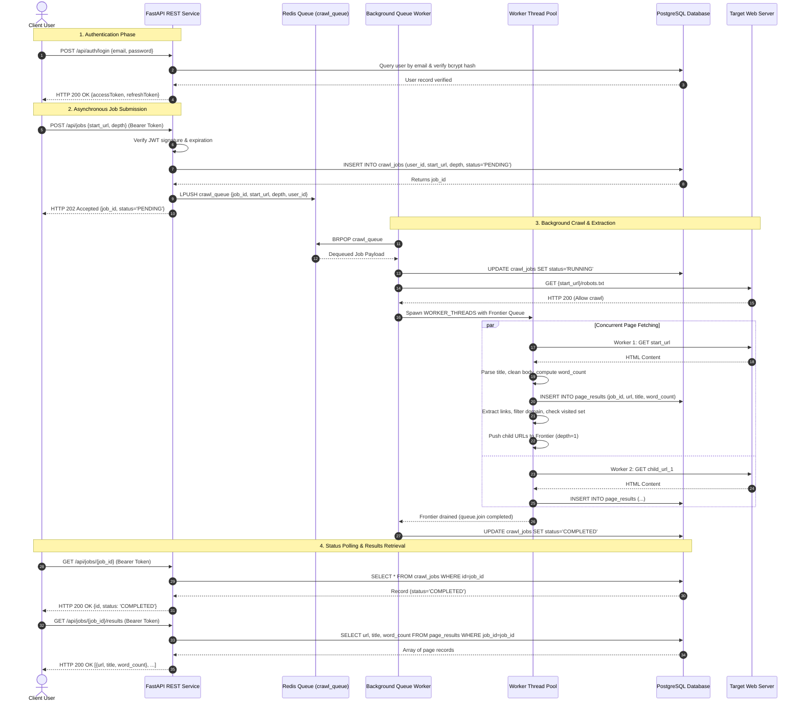

# 🚀 High-Concurrency Web Crawler & Content Analysis Service

[](https://fastapi.tiangolo.com)
[](https://python.org)
[](https://www.postgresql.org/)
[](https://redis.io/)
[](https://www.docker.com/)
[](https://jwt.io/)
[](LICENSE)

An enterprise-grade, asynchronous, multithreaded web crawling and content extraction platform built with **FastAPI**, **Redis**, **PostgreSQL**, and **Docker Compose**. The service enables authenticated users to submit distributed web scraping jobs, orchestrates worker thread pools for concurrent page analysis, handles depth limiting and same-domain URL deduplication, and persists extracted metadata and word statistics safely into relational storage.

---

## 📑 Table of Contents

- [Executive Summary](#-executive-summary)
- [System Architecture](#-system-architecture)
- [Execution Flow & Workflow](#-execution-flow--workflow)
- [Tech Stack & Justification](#-tech-stack--justification)
- [Repository Structure](#-repository-structure)
- [Key Features](#-key-features)
- [Getting Started & Local Setup](#-getting-started--local-setup)
- [API Documentation & Contracts](#-api-documentation--contracts)
- [Concurrency & Thread Safety](#-concurrency--thread-safety)
- [Testing & Quality Assurance](#-testing--quality-assurance)
- [Production Readiness](#-production-readiness)

---

## 🌟 Executive Summary

Modern web indexing and data extraction pipelines require high performance, non-blocking asynchronous user interaction, and resilient fault isolation:
- **Stateless RESTful API**: User management with dual-token JWT authentication (access & refresh tokens) and non-blocking job submission returning immediate `HTTP 202 Accepted` receipts.
- **Asynchronous Queue Decoupling**: High-throughput Redis FIFO queues decouple HTTP request cycles from heavy crawling operations.
- **Configurable Multithreaded Engine**: A dedicated worker thread pool spawns `WORKER_THREADS` concurrent workers per crawl job, coordinating page visits through synchronized frontiers.
- **Domain & Depth Governance**: Adheres strictly to seed domain boundaries, depth constraints (`depth: 0`, `depth: 1`, ...), and automated `robots.txt` compliance checking.
- **Persisted Relational Analysis**: Cleansed HTML payloads, extracted document titles, word frequencies, and run metrics are stored transactionally in PostgreSQL.

---

## 🏛 System Architecture

The following diagram demonstrates the multi-service architecture and interaction between client requests, authentication layers, the message broker, multithreaded worker pools, and relational persistence:

```mermaid
flowchart TB
    subgraph ClientLayer["Client & Consumers"]
        Client["Client / Automated Test Suite\n(curl / Postman / Tests)"]
    end

    subgraph AppService["Application Service (FastAPI & Workers)"]
        subgraph REST["REST API Layer"]
            AuthRouter["Auth Router\n(/api/auth/*)"]
            JobRouter["Job Management Router\n(/api/jobs/*)"]
            AuthMiddleware["JWT Bearer Authentication\n(Dependency Injection)"]
        end

        subgraph WorkerEngine["Multithreaded Worker Pool"]
            QueueListener["Queue Listener\n(Redis BRPOP Consumer)"]
            JobCoordinator["Job Crawler Coordinator\n(Thread Pool Manager)"]
            Thread1["Worker Thread 1\n(Fetcher & Parser)"]
            Thread2["Worker Thread 2\n(Fetcher & Parser)"]
            Thread3["Worker Thread N...\n(Fetcher & Parser)"]
            Frontier["Frontier Queue\n(queue.Queue - Thread-Safe)"]
            VisitedSet["Visited Registry\n(Set + Threading Lock)"]
        end
    end

    subgraph Infrastructure["Infrastructure & Persistence"]
        RedisQueue[("Redis Cache & Queue\nList: crawl_queue\n(Port 6379)")]
        PostgresDB[("PostgreSQL Database\n(Port 5432)\n- users\n- crawl_jobs\n- page_results")]
    end

    subgraph ExternalWeb["External Target Domain"]
        TargetWeb["Target Websites\n(HTTP/HTTPS Endpoints)"]
        RobotsTxt["/robots.txt Compliance"]
    end

    %% Client Interactions
    Client -->|"POST /api/auth/*\n(Register / Login / Refresh)"| AuthRouter
    Client -->|"POST /api/jobs (Submit Job)\nGET /api/jobs/{id}\nGET /api/jobs/{id}/results"| JobRouter
    JobRouter -.->|"Validates Token"| AuthMiddleware

    %% API to Infrastructure
    AuthRouter -->|"Verify / Store Users"| PostgresDB
    JobRouter -->|"1. Create Job (status=PENDING)"| PostgresDB
    JobRouter -->|"2. LPUSH Job Payload"| RedisQueue
    JobRouter -->|"Returns HTTP 202 + job_id"| Client

    %% Queue Worker Processing
    QueueListener -->|"BRPOP Job Payload"| RedisQueue
    QueueListener -->|"Spawns Coordinator"| JobCoordinator
    JobCoordinator -->|"Update status=RUNNING"| PostgresDB
    JobCoordinator -->|"Verify robots.txt"| RobotsTxt
    JobCoordinator -->|"Seed (start_url, depth=0)"| Frontier

    Frontier --> Thread1
    Frontier --> Thread2
    Frontier --> Thread3

    Thread1 <-->|"Deduplicate URLs"| VisitedSet
    Thread2 <-->|"Deduplicate URLs"| VisitedSet
    Thread3 <-->|"Deduplicate URLs"| VisitedSet

    Thread1 -->|"HTTP GET"| TargetWeb
    Thread2 -->|"HTTP GET"| TargetWeb
    Thread3 -->|"HTTP GET"| TargetWeb

    Thread1 -->|"Insert Discovered Links\n(if depth < max_depth)"| Frontier
    Thread2 -->|"Insert Discovered Links\n(if depth < max_depth)"| Frontier
    Thread3 -->|"Insert Discovered Links\n(if depth < max_depth)"| Frontier

    Thread1 -->|"Save Page Results"| PostgresDB
    Thread2 -->|"Save Page Results"| PostgresDB
    Thread3 -->|"Save Page Results"| PostgresDB

    JobCoordinator -->|"Update status=COMPLETED / FAILED"| PostgresDB
```



---

## 🔄 Execution Flow & Workflow

### 1. Job Submission & Async Processing Sequence



---

## 💻 Tech Stack & Justification

| Technology | Role | Justification |
|---|---|---|
| **Python 3.11+** | Application Core | Native support for robust threading primitives, memory management, and high-performance libraries. |
| **FastAPI** | REST API Framework | ASGI-powered asynchronous request processing, automatic OpenAPI/Swagger documentation, and Pydantic validation. |
| **Uvicorn** | ASGI Web Server | Lightning-fast asynchronous server implementation for Python with uvloop and httptools. |
| **PostgreSQL 15** | Primary Database | ACID compliance, transactional guarantees, relational integrity, and foreign key cascades. |
| **Redis 7** | Broker & Queue | Ultra-low latency memory data structure store; enables FIFO queue processing using atomic `LPUSH` and `BRPOP`. |
| **BeautifulSoup4** | HTML Parser | Resilient document parsing for extracting semantic page titles, stripping styling/scripts, and link normalization. |
| **PyJWT & Bcrypt** | Security & Auth | Industry-standard password hashing with adaptive salt rounds; stateless cryptographic token verification. |
| **Docker Compose** | Orchestration | Multi-service orchestration guaranteeing automated startup ordering, healthchecks, and isolated networking. |

---

## 📂 Repository Structure

```
.
├── .env.example              # Documented environment variables template
├── .gitignore                # Git ignore configuration
├── architecture.md           # Deep architectural specification & design document
├── projectdocumentation.md   # Comprehensive technical & operational documentation
├── Dockerfile                # Production-ready Docker container specification
├── README.md                 # Project README and quickstart guide
├── docker-compose.yml        # Orchestration definition for app, db, and cache
├── requirements.txt          # Python dependency declarations
├── submission.json           # Evaluation credentials contract file
├── db/
│   └── init.sql              # Database DDL schema and seed user migration
├── app/
│   ├── __init__.py           # Application package initializer
│   ├── config.py             # Environment configuration mapping
│   ├── database.py           # Thread-safe PostgreSQL connection pool & helpers
│   ├── main.py               # FastAPI application entrypoint & lifespan events
│   ├── auth/
│   │   ├── __init__.py
│   │   ├── jwt_handler.py    # Password hashing and JWT generation/validation
│   │   └── routes.py         # Authentication endpoints & security dependencies
│   ├── jobs/
│   │   ├── __init__.py
│   │   ├── models.py         # Pydantic schema models for requests and responses
│   │   └── routes.py         # Job creation, querying, and results endpoints
│   └── worker/
│       ├── __init__.py
│       ├── crawler.py        # Multithreaded crawler engine & HTML parser
│       └── queue_worker.py   # Redis background queue BRPOP listener
└── tests/
    └── test_crawler.py       # End-to-end integration and verification suite
```

---

## ⚡ Key Features

1. **Dual-Token JWT Security**:
   - Access tokens (15-minute TTL) for API operations.
   - Refresh tokens (7-day TTL) for seamless re-authentication without storing passwords.
   - Strict ownership isolation: Users can only query and retrieve their own jobs.

2. **Asynchronous Non-Blocking Processing**:
   - Submitting a crawl returns immediately with `HTTP 202 Accepted` and a unique `job_id`.
   - Redis FIFO queue decouples client web requests from long-running web scrapes.

3. **Multithreaded Concurrent Execution**:
   - Spawns a dedicated thread pool configurable via `WORKER_THREADS` (e.g. 4, 8, 16).
   - High I/O throughput: Workers fetch pages concurrently while parsing links and streaming results to PostgreSQL.

4. **Frontier & Deduplication Governance**:
   - Thread-safe FIFO `queue.Queue` manages the crawl frontier across all active worker threads.
   - Mutex-protected `visited` registry ensures each URL is crawled **only once**, preventing circular loops.
   - Strict base-domain matching prevents the crawler from leaving the seed website.

5. **Configurable Crawl Depth**:
   - `depth: 0`: Scrapes only the seed URL.
   - `depth: 1`: Scrapes seed URL and all directly referenced links.
   - Arbitrary depths supported with automatic termination.

6. **Robots.txt & Error Resiliency**:
   - Automated check of `{seed}/robots.txt`. If disallowed for user-agent `*`, flags job as `FAILED` with reasoning.
   - DNS failures, HTTP timeouts, and connection resets update job status to `FAILED` gracefully.

7. **Zero-Configuration Seeding**:
   - Automated database migrations and seed creation for evaluation accounts defined in `submission.json`.

---

## 🚀 Getting Started & Local Setup

### Prerequisites
- [Docker](https://docs.docker.com/get-docker/) (v20.10+)
- [Docker Compose](https://docs.docker.com/compose/) (v2.0+)
- (Optional for host running) Python 3.11+, PostgreSQL 15, Redis 7

### 1. Clone the Repository
```bash
git clone https://github.com/ramalokeshreddyp/high-concurrency-web-crawler.git
cd high-concurrency-web-crawler
```

### 2. Environment Configuration
Copy `.env.example` to `.env`:
```bash
cp .env.example .env
```

Review environment defaults:
```ini
PORT=8000
HOST=0.0.0.0
POSTGRES_HOST=db
POSTGRES_PORT=5432
POSTGRES_USER=postgres
POSTGRES_PASSWORD=postgres
POSTGRES_DB=crawler_db
REDIS_HOST=cache
REDIS_PORT=6379
REDIS_QUEUE_NAME=crawl_queue
JWT_SECRET_KEY=supersecretjwtkeyforcrawlerproductionchangeinrealdeployment12345
JWT_ALGORITHM=HS256
ACCESS_TOKEN_EXPIRE_MINUTES=15
REFRESH_TOKEN_EXPIRE_DAYS=7
WORKER_THREADS=4
CRAWL_TIMEOUT_SECONDS=10
```

### 3. Launch via Docker Compose
Build images and start all three orchestrated services (`app`, `db`, `cache`):
```bash
docker-compose up --build -d
```

### 4. Verify Health Status
Check container health:
```bash
docker-compose ps
```
Expected output:
```
NAME            IMAGE                STATUS                    PORTS
crawler_app     gpp-43-app           Up (healthy)              0.0.0.0:8000->8000/tcp
crawler_cache   redis:7-alpine       Up (healthy)              0.0.0.0:6379->6379/tcp
crawler_db      postgres:15-alpine   Up (healthy)              0.0.0.0:5432->5432/tcp
```

Interactive Swagger API docs will now be available at:
👉 **`http://localhost:8000/docs`**

---

## 📡 API Documentation & Contracts

### Authentication Endpoints

#### 1. Register User
`POST /api/auth/register`
```json
// Request Body
{
  "email": "developer@example.com",
  "password": "strongPassword123"
}

// Response: 201 Created
{
  "id": 2,
  "email": "developer@example.com"
}

// Response: 409 Conflict (Duplicate email)
{
  "detail": "Email already exists"
}
```

#### 2. Login User
`POST /api/auth/login`
```json
// Request Body
{
  "email": "user@example.com",
  "password": "password123"
}

// Response: 200 OK
{
  "accessToken": "eyJhbGciOi...",
  "refreshToken": "eyJhbGciOi..."
}

// Response: 401 Unauthorized
{
  "detail": "Invalid credentials"
}
```

#### 3. Refresh Access Token
`POST /api/auth/refresh`
```json
// Request Body
{
  "refreshToken": "eyJhbGciOi..."
}

// Response: 200 OK
{
  "accessToken": "eyJhbGciOi..."
}
```

---

### Job Management Endpoints (Requires `Authorization: Bearer <accessToken>`)

#### 4. Submit Crawl Job
`POST /api/jobs`
```json
// Request Body
{
  "start_url": "https://quotes.toscrape.com",
  "depth": 1
}

// Response: 202 Accepted
{
  "job_id": 1,
  "status": "PENDING",
  "message": "Job accepted for processing"
}
```

#### 5. Get Job Status & Metadata
`GET /api/jobs/{job_id}`
```json
// Response: 200 OK
{
  "id": 1,
  "start_url": "https://quotes.toscrape.com",
  "depth": 1,
  "status": "COMPLETED",
  "error_message": null,
  "created_at": "2026-11-07T05:00:00Z",
  "updated_at": "2026-11-07T05:00:15Z"
}
```

#### 6. Retrieve Extracted Page Results
`GET /api/jobs/{job_id}/results`
```json
// Response: 200 OK
[
  {
    "url": "https://quotes.toscrape.com/",
    "title": "Quotes to Scrape",
    "word_count": 521
  },
  {
    "url": "https://quotes.toscrape.com/page/2/",
    "title": "Quotes to Scrape",
    "word_count": 498
  }
]
```

---

## 🧵 Concurrency & Thread Safety

The crawling subsystem implements advanced multi-threading synchronization patterns:
- **`queue.Queue` Task Tracking**:
  - `frontier.put((url, depth))` atomically enqueues unexplored URLs.
  - Workers call `frontier.get()` and invoke `frontier.task_done()` after processing.
  - `frontier.join()` blocks the coordinator thread until the entire frontier queue is empty and all in-flight tasks have finished.
- **Mutex Protected Visited Registry**:
  - A `threading.Lock()` synchronizes URL deduplication across concurrent threads.
  - Normalization (fragment removal, domain lowercasing, relative path resolution) occurs before registry checks.
- **Threaded Database Connection Pool**:
  - `psycopg2.pool.ThreadedConnectionPool` ensures that concurrent worker threads never share a single database socket, preventing driver corruption.
- **Clean Thread Teardown**:
  - Sentinel `None` items pushed to the queue safely signal worker threads to break execution loops upon completion.

---

## 🧪 Testing & Quality Assurance

An end-to-end automated test suite is included in `tests/test_crawler.py` covering all 15 project requirements.

To run the integration test suite:
```bash
python tests/test_crawler.py
```

Test coverage includes:
- [x] Healthcheck endpoints (`/health` and `/api/health`).
- [x] Pre-seeded test user login from `submission.json`.
- [x] New user registration and duplicate email conflict (HTTP 409).
- [x] Invalid credential rejection (HTTP 401).
- [x] JWT token refresh workflow.
- [x] Route protection without authentication headers.
- [x] Single-page crawl with `depth: 0` (verifying exactly 1 result).
- [x] Multi-user cross-authorization boundaries (HTTP 403 / 404).
- [x] Resilient failure reporting on non-existent domains (`status: FAILED`).
- [x] Multi-page concurrent crawl with `depth: 1` (verifying URL deduplication across 40+ pages).

---

## 🔒 Production Readiness

- **Container Isolation**: Dockerized architecture with unprivileged container user practices.
- **Stateless API**: API instances can be scaled horizontally behind a reverse proxy (e.g. NGINX).
- **Graceful Shutdown**: The worker manager handles `SIGINT` / `SIGTERM` cleanly, allowing active transactions to finalize.
- **Structured Logging**: Timestamps, log levels, process IDs, and thread identifiers recorded for full auditability.

---

## 📄 License

This project is licensed under the MIT License.
