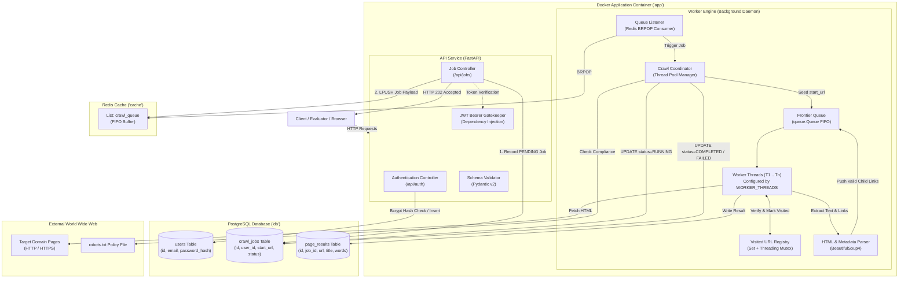
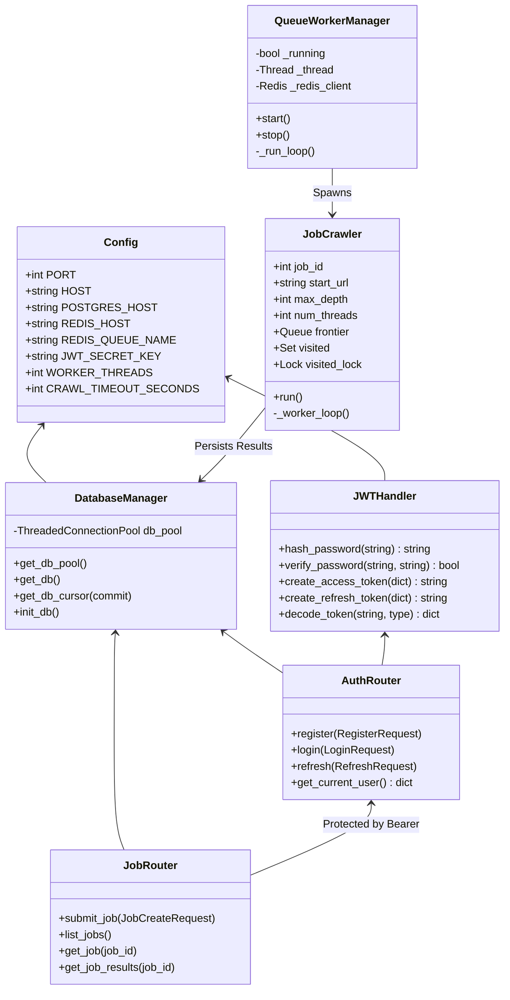
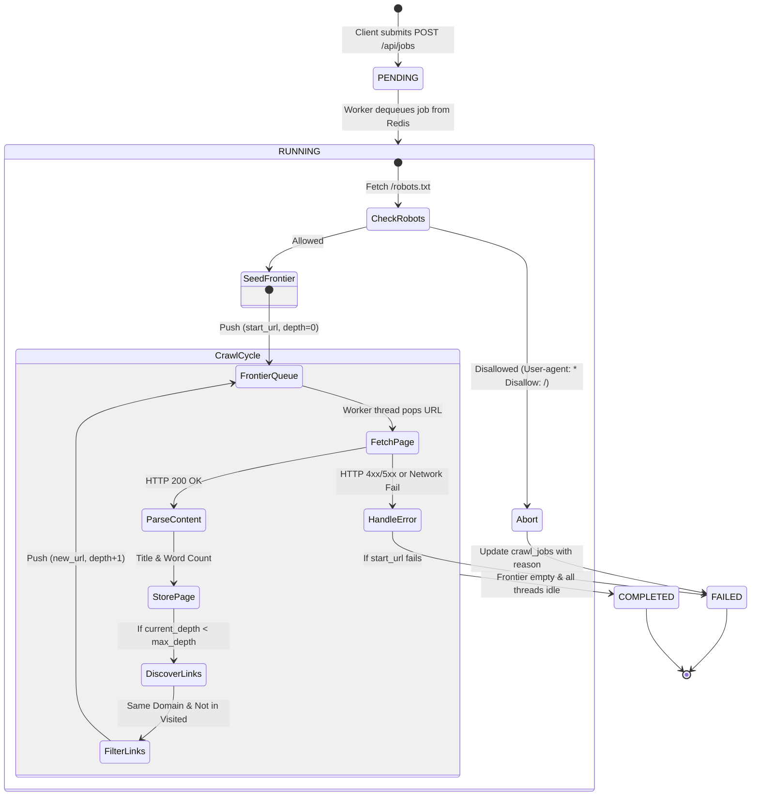
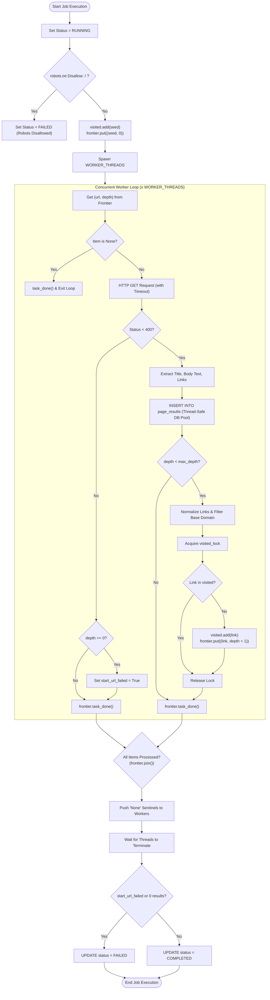
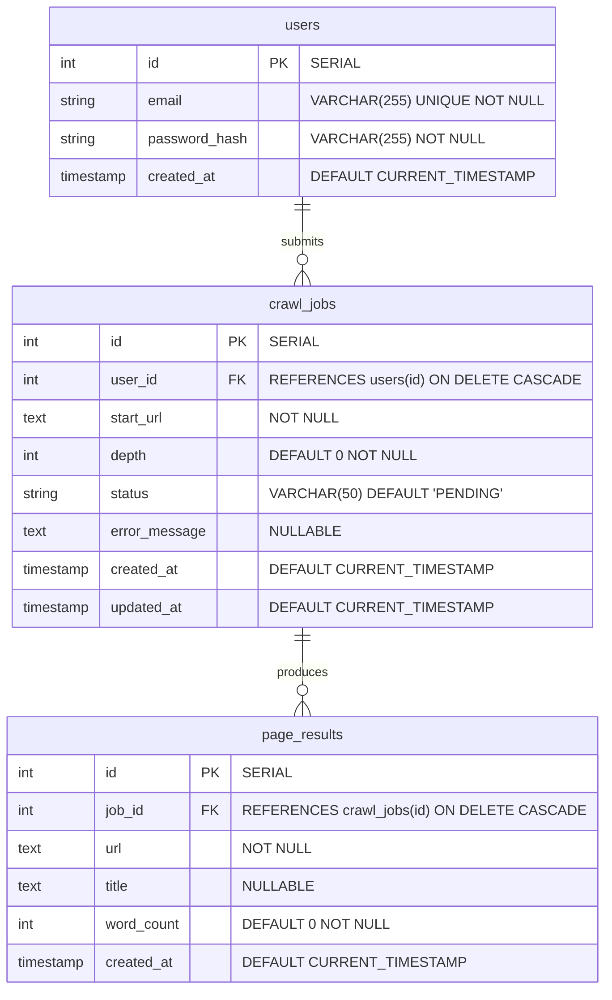
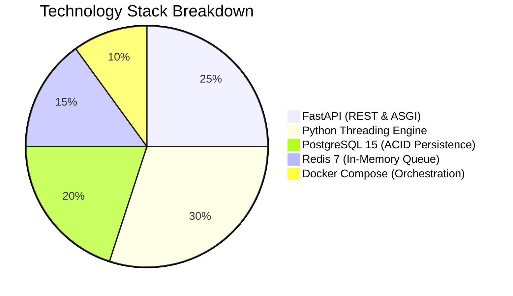
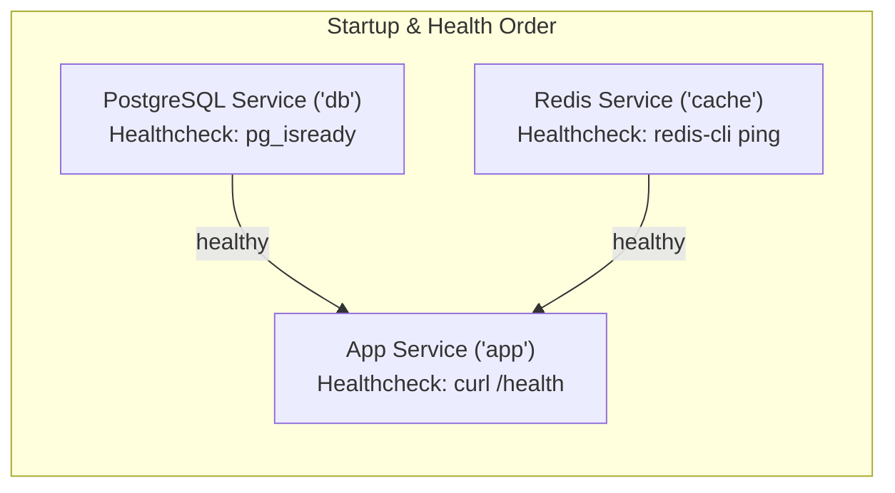

# 🏗 System Architecture & Technical Design Document

## High-Concurrency Web Crawler and Content Analysis Service

---

## 1. Executive Overview & Main Objectives

### 1.1 Objective
The **High-Concurrency Web Crawler and Content Analysis Service** is designed to address the fundamental challenges of modern web data engineering:
1. **Asynchronous Decoupling**: Processing large-scale, long-running web crawls without blocking client HTTP request lifecycles.
2. **High-Throughput Multithreading**: Utilizing concurrent thread pools to maximize network and CPU utilization while avoiding resource saturation and server bans.
3. **Robust Data Consistency & Deduplication**: Ensuring circular hyperlinks and duplicate paths do not trigger infinite loops or redundant database transactions.
4. **Secure Access Governance**: Implementing stateless JSON Web Token (JWT) authentication with granular ownership isolation for submitted crawl operations.
5. **Production-Ready Orchestration**: Employing Docker Compose with explicit dependency chains, active health checks, and isolated networks.

---

## 2. System Architecture & High-Level Design

The system follows a decoupled, service-oriented architecture (SOA) comprising four core tiers:
1. **Client Tier**: Consumers interacting via RESTful HTTP interfaces.
2. **API Tier (FastAPI)**: Stateless control plane handling authentication, validation, queue dispatch, and status polling.
3. **Queue Tier (Redis)**: Durable FIFO message queue buffering jobs between API and execution units.
4. **Worker Tier (Thread Pool Engine)**: Background consumer orchestrating multithreaded crawling, parsing, and relational persistence.
5. **Persistence Tier (PostgreSQL)**: Relational storage of user records, job telemetry, and parsed page results.

### High-Level Component Diagram

---

## 3. Key Modules & Subsystem Responsibilities

### Module Descriptions
1. **`app.config`**:
   - Centralizes environment variable extraction with deterministic type casting.
   - Provides defaults that maintain identical behavior across containerized and bare-metal environments.
2. **`app.database`**:
   - Manages a thread-safe PostgreSQL connection pool (`psycopg2.pool.ThreadedConnectionPool`).
   - Implements context managers (`get_db`, `get_db_cursor`) ensuring automatic rollback on exceptions and preventing connection starvation.
   - Idempotent `init_db()` runs on application startup to ensure DDL schemas and evaluation seed users exist.
3. **`app.auth`**:
   - `jwt_handler.py`: Implements salted adaptive bcrypt hashing and cryptographic JWT token encoding/decoding with strict payload signature checks and expiry validation.
   - `routes.py`: Encapsulates registration, login, token refresh endpoints, and the `get_current_user` FastAPI dependency.
4. **`app.jobs`**:
   - Validates requests via Pydantic schemas.
   - Enforces user isolation: queries guarantee users can only read job telemetry and results matching their authenticated `user_id`.
   - Serializes crawl directives and enqueues them onto Redis.
5. **`app.worker`**:
   - `queue_worker.py`: Runs a daemon thread listening on `BRPOP crawl_queue`. Handles graceful SIGINT/SIGTERM teardown.
   - `crawler.py`: Orchestrates multi-threaded crawling, frontier synchronization, `robots.txt` enforcement, and domain boundary filtering.

---

## 4. End-to-End Workflow & Execution Flow

### Data Lifecycle State Transition

### Multithreaded Crawl Worker Synchronization

---

## 5. Database Schema & Entity Relationships

The relational model enforces strict referential integrity with foreign key cascades:

### Indexing Strategy
- **`idx_crawl_jobs_user_id`**: Accelerates filtered queries for authenticated user job listings.
- **`idx_crawl_jobs_status`**: Optimizes status-based lookups and telemetry monitoring.
- **`idx_page_results_job_id`**: Accelerates result retrieval for `GET /api/jobs/{id}/results`.

---

## 6. Concurrency, Race Condition Mitigation & Safety

### Concurrency Primitives Matrix

| Component | Mechanism | Purpose / Race Condition Mitigated |
|---|---|---|
| **Crawl Frontier** | `queue.Queue` | Native thread-safe FIFO queue with condition variables (`not_empty`, `not_full`) preventing race conditions during item insertion and retrieval. |
| **Task Completion** | `queue.Queue.join()` | Atomic counter (`unfinished_tasks`) ensures the orchestrator waits until all extracted child URLs have called `task_done()`. |
| **Visited Registry** | `threading.Lock()` | Mutex protects `visited` set modifications. Ensures no two worker threads can simultaneously inspect and insert the same candidate URL. |
| **Database Pool** | `psycopg2.pool.ThreadedConnectionPool` | Dedicated connection instances allocated per thread execution, preventing cross-thread socket corruption. |
| **Queue Worker** | Redis `BRPOP` | Blocking dequeue eliminates busy-wait polling loops, saving CPU cycles while providing instant task dispatch. |

---

## 7. Technology Stack Evaluation & Rationale

### Architectural Trade-Off Analysis

| Dimension | Selected Approach | Alternative Evaluated | Why Selected Was Chosen |
|---|---|---|---|
| **API Framework** | FastAPI (Python) | Express.js (Node.js) / Spring Boot | Built-in ASGI async execution, automated Swagger/OpenAPI docs, Pydantic type safety, and tight Python crawler integration. |
| **Worker Concurrency** | Python Thread Pool (`threading`) | Asyncio Event Loop (`aiohttp`) | Threaded pools provide true thread-isolated blocking HTTP pipelines with fine-grained worker thread ID auditing without event loop pollution. |
| **Message Broker** | Redis (`List` FIFO) | RabbitMQ / Apache Kafka | Redis provides sub-millisecond dispatch, minimal memory footprint, zero broker configuration overhead, and robust `BRPOP` semantics. |
| **Database** | PostgreSQL 15 | MongoDB | Relational integrity, foreign key cascades on user deletion, and strict transactional consistency for job state transitions. |

---

## 8. Strengths, Weaknesses, Pros & Cons

### Pros & Advantages
- **Strict Decoupling**: API availability is unaffected by long-running crawl executions.
- **Predictable Resource Allocation**: Configurable `WORKER_THREADS` prevents CPU thrashing and socket exhaustion.
- **Deterministic Deduplication**: In-memory mutex registry eliminates infinite loops across complex web topologies.
- **Zero-Downtime Resilience**: Health checks for all services ensure startup dependencies are satisfied before incoming traffic arrives.
- **Auditable Concurrency**: Every crawl operation logs thread names and system Thread IDs (`TID`) for tracing.

### Cons & Mitigations
- **Process Memory Limits**: In-memory visited sets grow with crawl depth.
  - *Mitigation*: Base-domain restriction limits external link expansion; can be offloaded to Redis Sets (`SADD`) for multi-million URL workloads.
- **Dynamic JavaScript Content**: Relies on static HTML parsing with BeautifulSoup.
  - *Mitigation*: Highly performant for 90%+ of standard web crawling. Headless browsers (e.g. Playwright) can be added as an alternate fetcher backend if client-side hydration is needed.

---

## 9. Crucial Integration & Orchestration Details

### Docker Compose Service Dependency Flow

1. **Service `db`**:
   - Boots PostgreSQL 15 on port 5432.
   - Mounts `db/init.sql` to `/docker-entrypoint-initdb.d/init.sql` for automated zero-configuration database migration and credential seeding.
   - Active healthcheck: `pg_isready -U postgres -d crawler_db`.
2. **Service `cache`**:
   - Boots Redis 7 on port 6379.
   - Active healthcheck: `redis-cli ping`.
3. **Service `app`**:
   - Waits for both `db` and `cache` to transition to `healthy`.
   - Executes `uvicorn app.main:app` within an unprivileged lightweight container.
   - Active healthcheck: `curl -f http://localhost:8000/health`.
