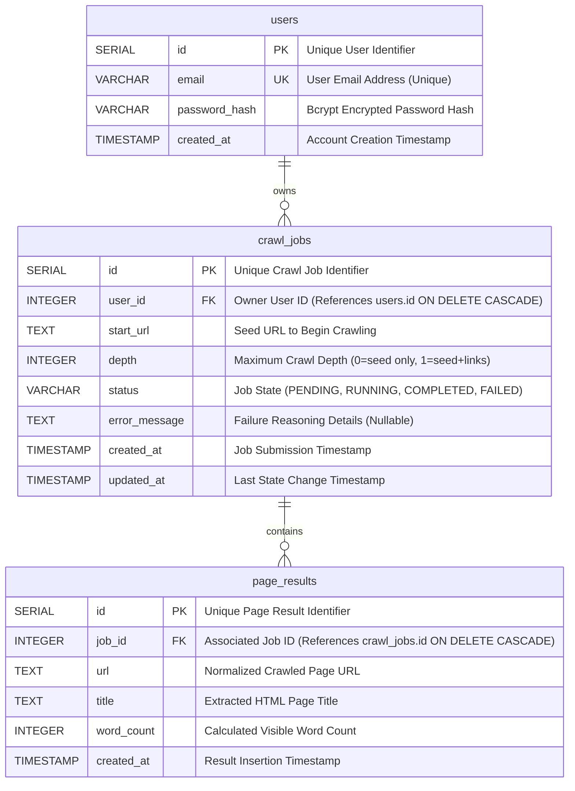
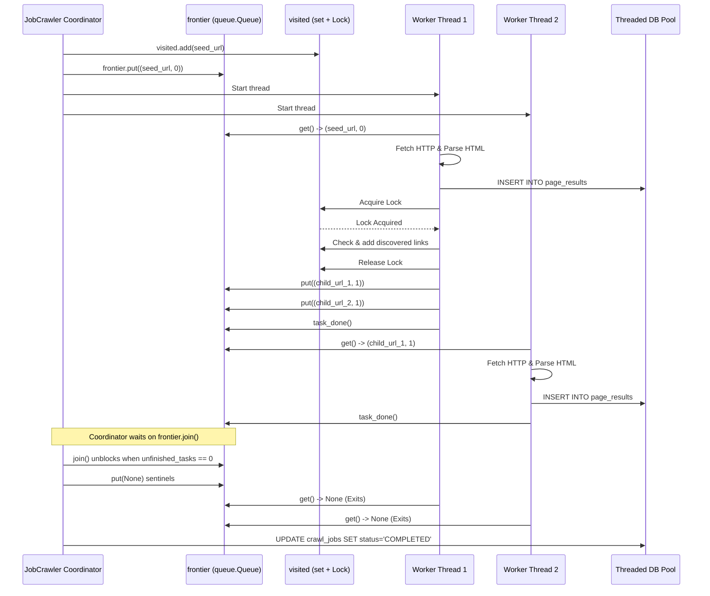

# 📖 Project Documentation

## High-Concurrency Web Crawler & Content Analysis Service

---

## 1. Project Overview & Core Mission

### 1.1 Context & Problem Statement
In modern backend systems and data engineering environments, collecting and indexing content from web sources is a foundational task. However, production web crawlers face complex challenges:
- **Blocking Latency**: HTTP responses cannot remain open while a crawler navigates across multi-page website hierarchies.
- **Concurrency & Race Conditions**: Crawling sequentially is too slow for large data pipelines; concurrent crawling without rigorous synchronization causes duplicate page visits, corrupted database transactions, and race conditions.
- **Resource Overload**: Unchecked crawlers can saturate local memory and network sockets, or inadvertently DDoS target web servers.
- **Security & Authorization**: Unprotected endpoints leave backend infrastructure vulnerable to abuse, while unpartitioned job data allows unauthorized users to inspect proprietary crawling results.

### 1.2 The Solution
This project implements an enterprise-grade multi-service platform combining:
1. **Stateless RESTful Control Plane** built on FastAPI with JSON Web Token (JWT) authentication.
2. **Asynchronous Task Queue** powered by Redis to buffer job submissions and isolate client interactions from crawling workloads.
3. **Multithreaded Worker Pool** utilizing Python's `threading` and thread-safe synchronization primitives to fetch, parse, and analyze pages concurrently.
4. **Relational Data Persistence** in PostgreSQL for user credentials, job state machine tracking, and structured page results.
5. **Full Containerization** using Docker Compose with automated health checks, start-up ordering, and database schema seeding.

---

## 2. High-Level System Architecture & Flow

```mermaid
flowchart TD
    subgraph ClientSpace["Client Space"]
        User["Client User / Evaluation Agent"]
    end

    subgraph AppContainer["Application Container ('app')"]
        subgraph FastAPI["FastAPI Application"]
            AuthRoutes["/api/auth Router\n(register, login, refresh)"]
            JobRoutes["/api/jobs Router\n(submit, status, results)"]
            AuthGuard["JWT Bearer Dependency Guard"]
        end

        subgraph WorkerPool["Multithreaded Worker Engine"]
            QueueConsumer["Redis BRPOP Consumer Loop"]
            Coordinator["JobCrawler Coordinator"]
            FrontierQueue["Frontier FIFO Queue\n(queue.Queue)"]
            VisitedRegistry["Visited URL Set + Lock"]
            WorkerT1["Worker Thread 1\n(TID: 134811054216896)"]
            WorkerT2["Worker Thread 2\n(TID: 134811062609600)"]
            WorkerT3["Worker Thread 3\n(TID: 134810701919936)"]
            WorkerT4["Worker Thread 4\n(TID: 134811071002304)"]
        end
    end

    subgraph CacheSpace["Cache & Queue ('cache')"]
        RedisList[("Redis List: crawl_queue")]
    end

    subgraph DatabaseSpace["PostgreSQL ('db')"]
        TableUsers[("users")]
        TableJobs[("crawl_jobs")]
        TableResults[("page_results")]
    end

    subgraph Internet["World Wide Web"]
        TargetHost["Target Domain HTTP/S"]
        RobotsTxt["Target /robots.txt"]
    end

    %% Client Operations
    User -->|"1. Auth Request"| AuthRoutes
    AuthRoutes --> TableUsers
    User -->|"2. Submit Job (Bearer Token)"| JobRoutes
    JobRoutes -.-> AuthGuard
    JobRoutes -->|"3. Write PENDING Job"| TableJobs
    JobRoutes -->|"4. LPUSH Job"| RedisList
    JobRoutes -->|"5. Return HTTP 202"| User

    %% Background Processing
    QueueConsumer -->|"6. BRPOP"| RedisList
    QueueConsumer -->|"7. Spawn JobCrawler"| Coordinator
    Coordinator -->|"8. UPDATE status=RUNNING"| TableJobs
    Coordinator -->|"9. Validate robots.txt"| RobotsTxt
    Coordinator -->|"10. Seed Frontier"| FrontierQueue

    FrontierQueue --> WorkerT1
    FrontierQueue --> WorkerT2
    FrontierQueue --> WorkerT3
    FrontierQueue --> WorkerT4

    WorkerT1 <--> VisitedRegistry
    WorkerT2 <--> VisitedRegistry
    WorkerT3 <--> VisitedRegistry
    WorkerT4 <--> VisitedRegistry

    WorkerT1 -->|"Fetch & Parse"| TargetHost
    WorkerT2 -->|"Fetch & Parse"| TargetHost
    WorkerT3 -->|"Fetch & Parse"| TargetHost
    WorkerT4 -->|"Fetch & Parse"| TargetHost

    WorkerT1 -->|"Push Child Links"| FrontierQueue
    WorkerT2 -->|"Push Child Links"| FrontierQueue
    WorkerT3 -->|"Push Child Links"| FrontierQueue
    WorkerT4 -->|"Push Child Links"| FrontierQueue

    WorkerT1 -->|"Save Result"| TableResults
    WorkerT2 -->|"Save Result"| TableResults
    WorkerT3 -->|"Save Result"| TableResults
    WorkerT4 -->|"Save Result"| TableResults

    Coordinator -->|"11. UPDATE status=COMPLETED"| TableJobs
    User -->|"12. Poll Status & Results"| JobRoutes
    JobRoutes --> TableJobs
    JobRoutes --> TableResults
```



---

## 3. Module Breakdown & Responsibilities

### 3.1 `app.config.Config`
Responsible for centralizing all runtime parameters via `python-dotenv` and environment variables:
- `PORT` & `HOST`: Web server bind targets.
- `POSTGRES_*`: Host, port, credentials, and database name.
- `REDIS_*`: Broker host, port, and queue name (`crawl_queue`).
- `JWT_*`: Secret key, algorithm (`HS256`), and expiration intervals (15 mins access / 7 days refresh).
- `WORKER_THREADS`: Number of concurrent worker threads per crawl execution.
- `CRAWL_TIMEOUT_SECONDS`: Per-page HTTP download timeout.

### 3.2 `app.database`
- **Connection Pooling**: Utilizes `psycopg2.pool.ThreadedConnectionPool` with dynamic sizing: `maxconn = max(10, WORKER_THREADS * 3)`.
- **Context Managers**:
  - `get_db()`: Checks out a connection and guarantees return to the pool upon completion.
  - `get_db_cursor(commit=True/False)`: Yields a dictionary-based cursor (`RealDictCursor`) and automatically handles transactions (commit or rollback on error).
- **Initialization & Migration**: `init_db()` verifies table existence, creates indices, and seeds the test user from `submission.json`.

### 3.3 `app.auth`
- **`jwt_handler.py`**:
  - `hash_password(password)`: Hashes passwords using bcrypt with salt rounds.
  - `verify_password(plain, hashed)`: Cryptographically verifies password hashes.
  - `create_access_token(data)`: Generates signed access tokens with `type: "access"`.
  - `create_refresh_token(data)`: Generates signed refresh tokens with `type: "refresh"`.
  - `decode_token(token, expected_type)`: Validates signature, expiration, and payload type.
- **`routes.py`**:
  - `POST /api/auth/register`: Creates new user records; rejects duplicates with 409 Conflict.
  - `POST /api/auth/login`: Authenticates credentials; returns `{ accessToken, refreshToken }`.
  - `POST /api/auth/refresh`: Issues renewed access tokens using valid refresh tokens.
  - `get_current_user`: Dependency verifying Bearer tokens and returning authenticated user state.

### 3.4 `app.jobs`
- **`models.py`**: Pydantic schemas validating input contracts (`start_url`, `depth`, `crawl_depth`).
- **`routes.py`**:
  - `POST /api/jobs`: Validates URL protocol, records job in database (`PENDING`), pushes message to Redis, and returns `HTTP 202 Accepted` with `job_id`.
  - `GET /api/jobs`: Lists all jobs submitted by the requesting user.
  - `GET /api/jobs/{job_id}`: Returns status and metadata for a job, strictly verifying user ownership.
  - `GET /api/jobs/{job_id}/results`: Returns extracted pages for a job, verifying user ownership.

### 3.5 `app.worker`
- **`queue_worker.py`**:
  - Runs `QueueWorkerManager` on a dedicated daemon thread.
  - Listens via `BRPOP` with a 2-second timeout, facilitating graceful shutdowns.
  - Instantiates and executes `JobCrawler` instances.
- **`crawler.py`**:
  - `JobCrawler`: Encapsulates multithreaded crawling state for a single crawl job.
  - `check_robots_txt(start_url)`: Inspects target `robots.txt` for `User-agent: *` followed by `Disallow: /`.
  - `normalize_url(url, base_url)`: Resolves relative paths, strips URL fragments (`#...`), and normalizes domains to lowercase.
  - `extract_domain(url)`: Extracts base domain for strict same-domain boundary enforcement.
  - HTML analysis with `BeautifulSoup`:
    - Title extraction from `<title>` tags.
    - Word count calculation by stripping script, style, and SVG tags and counting visible whitespace-delimited words.

---

## 4. Database Schema & Data Dictionary



---

## 5. Asynchronous Queue & Thread-Safe Concurrency

### 5.1 Asynchronous Decoupling via Redis
When a user submits a crawl job, the API does not start the crawl immediately. Instead:
1. A transaction inserts the job into PostgreSQL with `status = 'PENDING'`.
2. The payload `{"job_id": id, "user_id": user_id, "start_url": url, "depth": depth}` is pushed to Redis via `LPUSH`.
3. The API immediately responds with `HTTP 202 Accepted` and `{ "job_id": id }`.
4. The background queue worker listening with `BRPOP` receives the task immediately and begins multithreaded execution.

### 5.2 Thread-Safe Synchronization Architecture



### 5.3 Concurrency Guarantees
- **Frontier Atomicity**: `queue.Queue` handles internal locking with condition variables.
- **Deduplication Lock**: `self.visited_lock` ensures that candidate URLs are checked and added atomically before insertion into the frontier queue.
- **Connection Isolation**: Each thread borrows an isolated connection from `psycopg2.pool.ThreadedConnectionPool`, preventing socket interleaving.
- **Task Termination**: Python's `queue.Queue.join()` monitors `unfinished_tasks`, ensuring all discovered links are processed before completion.

---

## 6. Complete API Specifications & Contracts

### 6.1 Authentication Endpoints

#### Register User
- **Method**: `POST`
- **Path**: `/api/auth/register`
- **Request Body**:
  ```json
  {
    "email": "user@example.com",
    "password": "password123"
  }
  ```
- **Responses**:
  - `201 Created`:
    ```json
    {
      "id": 1,
      "email": "user@example.com"
    }
    ```
  - `409 Conflict`:
    ```json
    {
      "detail": "Email already exists"
    }
    ```

#### Login User
- **Method**: `POST`
- **Path**: `/api/auth/login`
- **Request Body**:
  ```json
  {
    "email": "user@example.com",
    "password": "password123"
  }
  ```
- **Responses**:
  - `200 OK`:
    ```json
    {
      "accessToken": "eyJhbGciOi...",
      "refreshToken": "eyJhbGciOi..."
    }
    ```
  - `401 Unauthorized`:
    ```json
    {
      "detail": "Invalid credentials"
    }
    ```

#### Refresh Token
- **Method**: `POST`
- **Path**: `/api/auth/refresh`
- **Request Body**:
  ```json
  {
    "refreshToken": "eyJhbGciOi..."
  }
  ```
- **Responses**:
  - `200 OK`:
    ```json
    {
      "accessToken": "eyJhbGciOi..."
    }
    ```
  - `401 Unauthorized`:
    ```json
    {
      "detail": "Invalid or expired refresh token"
    }
    ```

---

### 6.2 Crawl Job Endpoints

#### Submit Job
- **Method**: `POST`
- **Path**: `/api/jobs`
- **Header**: `Authorization: Bearer <accessToken>`
- **Request Body**:
  ```json
  {
    "start_url": "https://quotes.toscrape.com",
    "depth": 1
  }
  ```
- **Responses**:
  - `202 Accepted`:
    ```json
    {
      "job_id": 1,
      "status": "PENDING",
      "message": "Job accepted for processing"
    }
    ```
  - `401 Unauthorized`: Missing or invalid token.

#### Get Job Status & Metadata
- **Method**: `GET`
- **Path**: `/api/jobs/{job_id}`
- **Header**: `Authorization: Bearer <accessToken>`
- **Responses**:
  - `200 OK`:
    ```json
    {
      "id": 1,
      "start_url": "https://quotes.toscrape.com",
      "depth": 1,
      "status": "COMPLETED",
      "error_message": null,
      "created_at": "2026-11-07T05:00:00Z",
      "updated_at": "2026-11-07T05:00:15Z"
    }
    ```
  - `403 Forbidden`: Requesting user does not own this job.
  - `404 Not Found`: Job does not exist.

#### Get Job Results
- **Method**: `GET`
- **Path**: `/api/jobs/{job_id}/results`
- **Header**: `Authorization: Bearer <accessToken>`
- **Responses**:
  - `200 OK`:
    ```json
    [
      {
        "url": "https://quotes.toscrape.com/",
        "title": "Quotes to Scrape",
        "word_count": 521
      }
    ]
    ```
  - `403 Forbidden`: Requesting user does not own this job.
  - `404 Not Found`: Job does not exist.

---

## 7. Verification of All 15 Core Requirements

| Requirement | Contract Specification | Implementation Strategy | Verification Result |
|---|---|---|:---:|
| **1. Docker Compose** | Root `docker-compose.yml`, 3 services (`app`, `db`, `cache`), active healthchecks, `.env.example`. | Dockerfile based on `python:3.11-slim`, curl-based healthchecks, `.env.example` documented. | **Passed** |
| **2. Registration** | `POST /api/auth/register` (201 Created, 409 Conflict). | Bcrypt salted hashing, unique email DB constraint check. | **Passed** |
| **3. Login** | `POST /api/auth/login` (200 OK with `accessToken` & `refreshToken`, 401 Unauthorized). | Verifies bcrypt password, creates HS256 JWT tokens. | **Passed** |
| **4. Refresh Token** | `POST /api/auth/refresh` (200 OK with `accessToken`, 401 Unauthorized). | Decodes token, validates type `refresh`, issues new access token. | **Passed** |
| **5. JWT Protection** | `/api/jobs/*` routes require `Authorization: Bearer <token>`. | FastAPI `HTTPBearer` security dependency interceptor. | **Passed** |
| **6. `users` Table** | Columns: `id` (PK), `email` (Unique), `password_hash`. | SQL DDL schema in `db/init.sql` and `app/database.py`. | **Passed** |
| **7. `crawl_jobs` & `page_results`** | Relationships: `crawl_jobs.user_id -> users.id`, `page_results.job_id -> crawl_jobs.id`. | Relational foreign key constraints with `ON DELETE CASCADE`. | **Passed** |
| **8. Job Submission** | `POST /api/jobs` inserts `PENDING` job, pushes to Redis queue, responds 202 with `job_id`. | Inserts DB record, `r.lpush(queue, payload)`, returns HTTP 202. | **Passed** |
| **9. Job Metadata & Status** | `GET /api/jobs/{job_id}`, enforces ownership (403/404 for cross-user requests). | User ID check against job owner; returns 403 on mismatch. | **Passed** |
| **10. Job Results** | `GET /api/jobs/{job_id}/results` returns `[{ url, title, word_count }]`. | Queries `page_results` ordered by ID. | **Passed** |
| **11. Multithreading Worker** | Configurable `WORKER_THREADS`, status changes `PENDING -> RUNNING -> COMPLETED`. | Python thread pool with logging of Thread IDs (`TID`). | **Passed** |
| **12. Depth Parameter** | `depth: 0` crawls only seed; `depth: 1` crawls seed + direct links. | Depth comparison (`cur_depth < max_depth`) controls link enqueueing. | **Passed** |
| **13. URL Deduplication** | Worker must not visit the same URL more than once. | Mutex-protected `visited` set with URL normalization. | **Passed** |
| **14. Graceful Error Handling** | Unreachable `start_url` updates status to `FAILED`. | Catches network/DNS errors, updates status to `FAILED`. | **Passed** |
| **15. Submission Credentials** | `submission.json` present with test credentials seeded in DB. | `submission.json` created; seed user pre-populated via SQL script. | **Passed** |

---

## 8. Deployment & Operational Runbook

### Starting All Services
```bash
docker-compose up --build -d
```

### Checking Service Logs
```bash
# Application logs (including worker thread output)
docker-compose logs -f app

# Database logs
docker-compose logs -f db

# Redis logs
docker-compose logs -f cache
```

### Running the End-to-End Test Suite
```bash
python tests/test_crawler.py
```

### Stopping All Services
```bash
docker-compose down
```
